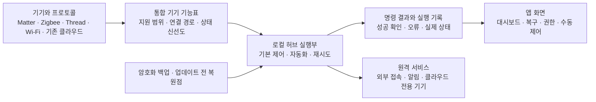

# 스마트홈 기본 베이스에 추가할 기능 조사

**기준일:** 2026년 10월 10일  
**조사 질문:** 앞서 확인한 사용자 수요를 해결하려면 스마트홈의 공통 기반(허브·기기 연결·자동화·앱)에 어떤 기능을 더해야 하는가?

## 결론 요약

스마트홈 기본 베이스에 먼저 추가할 것은 AI 비서나 자동화 시나리오의 수가 아니다. **인터넷이 끊겨도 집 안의 기본 제어를 유지하고, 명령이 실제 기기에 적용됐는지 확인하며, 실패 원인을 설명하고, 기기를 다시 등록해도 집 설정을 복구하는 기능**이다.

Matter 1.6은 설정 절차, 생태계 간 기기 공유, 기기 기능·작동 한계·보안 센서 이력 전달을 보강했다. 그러나 표준 지원이 곧 플랫폼별 완전한 기능 지원을 뜻하지 않는다. Google Home 개발 문서도 지원 Matter 기기 유형 중 일부는 완전 지원되지 않는다고 밝힌다. 따라서 기본 베이스는 단순히 “Matter 지원” 배지를 표시하는 대신, 모델·지역·펌웨어별로 가능한 제어와 자동화를 공개해야 한다. [Matter 1.6 발표](https://csa-iot.org/newsroom/matter-1-6-enables-more-intuitive-setup-multi-ecosystem-experiences-and-context-driven-control/), [Google Home 지원 기기 유형](https://developers.home.google.com/matter/supported-devices)

## 근거와 해석

앞선 탐색 조사에서는 연결 끊김·호환성, 상태 동기화, 설정 후 복구, 센서·자동화 신뢰성, 개인정보 통제가 문제로 나타났다. 표본이 무작위 400건이 아닌 40건이므로 빈도 순위를 시장 전체에 일반화하지 않고, 기능 설계의 출발점으로만 사용했다. [앞선 탐색 보고서](./스마트홈_불만_탐색보고서_2026-10-10.md)

공식 문서에서도 기반 기능의 중요성이 확인된다. SmartThings는 허브 연결 기기와 자동화를 가능한 경우 로컬에서 실행하지만, 자동화에 포함된 기능이나 서비스 중 하나라도 로컬 실행을 지원하지 않으면 클라우드에서 실행한다고 안내한다. Home Assistant는 Matter·Zigbee·Z-Wave·Thread 등 로컬 연결 기기는 인터넷이 끊겨도 동작할 수 있지만, 제조사 클라우드만 사용하는 기기는 인터넷 장애 시 제어되지 않는다고 설명한다. 즉, 로컬 제어 여부는 플랫폼 전체에 대한 추상적인 약속보다 **자동화·기기별 실행 경로**로 보여줘야 한다. [SmartThings 자동화 실행 방식](https://developer.smartthings.com/docs/automations/rules), [Home Assistant 오프라인 동작](https://www.home-assistant.io/faq/works-without-internet)

자동화 실패를 이해하는 기능도 이미 일부 플랫폼에 존재한다. Home Assistant의 실행 기록은 어떤 트리거가 시작했고, 조건이 통과했는지, 어느 동작에서 실패했는지 보여준다. 다만 기본 보관량은 자동화별 최근 5회다. 기본 베이스는 이런 진단 기능을 일반 사용자용 화면에 포함하고, 최근 기록과 실제 기기 확인 상태를 함께 보여줄 필요가 있다. [자동화 실행 기록과 테스트](https://www.home-assistant.io/docs/automation/testing/), [자동화 문제 해결](https://www.home-assistant.io/docs/automation/troubleshooting/)

## 추가 기능 우선순위

| 우선순위 | 기본 베이스 기능 | 해결할 사용자 문제 | 권장 동작 |
|---|---|---|---|
| **P0** | 로컬 우선 제어와 자동화 | 인터넷·클라우드 장애 때 조명·센서·스위치가 함께 멈춤 | 로컬 가능 기기와 자동화는 허브에서 실행한다. 클라우드 실행이 필요한 단계는 설정 화면과 자동화별로 표시한다. WAN 연결을 잃어도 로컬 제어를 유지한다. |
| **P0** | 실제 상태 확인과 명령 결과 | 앱에는 켜졌다고 보이지만 기기는 반응하지 않거나 상태가 늦게 갱신됨 | 명령 전송과 기기의 확인 응답을 구분한다. 결과를 성공 확인·실패·응답 대기·지원 안 됨으로 표시하고, 마지막 상태 갱신 시각과 연결 경로를 보여준다. |
| **P0** | 자동화 실행 이력·실패 설명 | 자동화가 왜 안 됐는지 알 수 없고 오작동 원인을 추적하기 어려움 | 트리거, 조건별 판단, 수행 동작, 기기 응답, 오류를 한 화면에서 보여준다. 사용자가 원하면 실행 기록을 최소 30일 보관하는 옵션을 제공한다. |
| **P0** | 기기별 호환성·기능표 | “연동 지원”이라고 해도 핵심 기능이 빠지거나 기기마다 작동이 다름 | 모델·지역·펌웨어별로 추가/제어/상태 확인/자동화/로컬 실행/원격 제어 가능 여부를 공개한다. 확인 날짜와 미지원 기능도 기록한다. |
| **P0** | 설정 실패 진단과 재등록 복구 | 연결 실패 후 집·방·루틴을 처음부터 다시 만들어야 함 | QR/NFC/자동 검색을 제공하고, 페어링의 어느 단계에서 실패했는지 안내한다. 재시도·허브 변경·기기 교체를 해도 기존 이름·방·자동화가 삭제되지 않도록 한다. |
| **P0** | 백업·기기 교체·이사 복원 | 허브 고장·앱 초기화·이사 뒤 설정 손실 | 암호화된 자동 백업, 업데이트 전 백업, 로컬/사용자 선택 원격 저장, 새 허브에서 복원, 기존 기기를 새 기기로 바꾸는 자동화 재연결을 지원한다. |
| **P1** | 수동 우선·자동화 일시 중지 | 센서 오작동이 조명을 끄거나 난방·환기 동작을 방해함 | 벽 스위치와 앱 수동 조작이 자동화보다 우선되게 한다. 특정 자동화를 일정 시간 또는 사용자가 다시 켤 때까지 중지할 수 있게 한다. |
| **P1** | 권한·로컬/원격·가족 계정 제어 | 마이크·카메라·위치 권한과 계정 공유를 세밀하게 통제하기 어려움 | 마이크·카메라를 기능별로 끄고, 원격 연결을 별도 설정하며, 가족/손님/관리자별 권한을 나눈다. 이벤트 이력에서 누가 무엇을 제어했는지 표시한다. |
| **P1** | 센서·네트워크 건강 상태 | 배터리 저하·신호 약화·센서 오판이 늦게 발견됨 | 배터리, 마지막 응답, 신호 품질, 상태가 오래된 센서, 반복 재접속을 홈 건강 화면에서 알려준다. 조명·잠금·난방 등 중요 기기는 오작동 위험도 함께 표시한다. |
| **P2** | 접근성·빠른 제어·세밀한 일정 | 음성만으로 제어할 수 없거나 위젯·시간 설정이 부족함 | 홈 화면/워치 위젯, 키보드 제어, 읽기 쉬운 상태 표시, 자정을 넘는 시간 설정, 공유 가능한 기본 루틴을 제공한다. |

Matter는 QR/숫자 코드와 BLE를 이용한 설정, 여러 플랫폼에 기기를 공유하는 Multi-Admin을 정의한다. Matter 1.6은 NFC 기반 전체 설정과 기기 기능·제한을 표준화해 전달하는 기능을 더했다. 따라서 NFC/QR 설정과 여러 플랫폼 공유는 새로운 자체 프로토콜을 만들기보다 표준을 기반으로 구현할 수 있다. 다만 기존 Zigbee·Z-Wave 기기는 브리지로 Matter 생태계에 연결할 수 있으며, Matter 자체가 이 프로토콜들과 직접 호환되는 것은 아니다. [CSA Matter FAQ](https://csa-iot.org/all-solutions/matter/matter-faq/), [Matter 1.6 발표](https://csa-iot.org/newsroom/matter-1-6-enables-more-intuitive-setup-multi-ecosystem-experiences-and-context-driven-control/)

## 권장 기본 구조

이 구조에서 클라우드는 없어지지 않는다. 외부에서 집에 접속하거나 클라우드 전용 제품을 연결하는 용도로 유지하되, 집 안의 기본 제어와 로컬 자동화는 허브에서 계속 실행하는 구성이 적절하다. Home Assistant 문서는 기본적으로 로컬 네트워크에서 동작하고, 원격 제어는 보안된 클라우드 또는 VPN 같은 선택 경로로 제공한다. [원격 접속 방식](https://www.home-assistant.io/docs/configuration/remote/)

## 출시 전 검증 기준 제안

아래 기준은 조사에서 측정한 시장 수치가 아니라, 기능 구현을 검증하기 위한 제안이다.

1. **인터넷 장애:** WAN을 30분 차단해도 로컬 가능 기기의 수동 제어와 로컬 자동화가 유지되고, 클라우드 전용 기기는 이유가 표시된다.
2. **상태 진실성:** 기기가 확인 응답을 주지 않으면 화면에 성공으로 표시하지 않는다. 상태가 오래되면 값과 함께 마지막 갱신 시각을 보인다.
3. **실행 기록:** 자동화 한 건에서 트리거, 조건 판단, 동작 실행, 기기 응답 또는 실패 원인을 일반 사용자도 읽을 수 있다.
4. **연결 복구:** 재시도·허브 교체·기기 교체 과정에서 방 이름, 자동화, 가족 공유 권한이 보존되고, 바뀐 기기에 연결할 항목을 검토할 수 있다.
5. **백업 복원:** 사용자 계정 또는 제조사 클라우드 하나에만 묶이지 않은 암호화 백업으로 다른 허브에 집 설정을 복원한다. Home Assistant는 자동 암호화 백업, 여러 저장 위치, 복원/하드웨어 이전을 지원하는 참고 사례다. [백업과 복원](https://www.home-assistant.io/common-tasks/general/)
6. **호환성 사전 확인:** 구매 전 해당 모델이 어떤 기능을 지원하는지와 로컬·원격 실행 여부를 확인할 수 있다.

## AI 기능의 위치

자연어 AI는 “퇴근 모드 만들어줘” 같은 요청을 자동화 초안으로 바꾸고, 사용자가 실행 전에 조건과 동작을 검토하게 하는 데 적합하다. 실제 기기 제어는 승인된 규칙 엔진이 수행하고, 도어락·난방·전열기처럼 영향이 큰 동작은 확인 절차와 수동 중지 수단을 둔다. 이는 스마트홈 음성 제어에서 응답 속도·명령 정확성·예측 가능성을 중시한 커뮤니티 의견을 반영한 설계 제안이다. [스마트홈 음성 AI 논의](https://gall.dcinside.com/mgallery/board/view/?id=smartthings&no=15992)

## 최종 권고

기본 베이스의 MVP에는 **로컬 제어, 실제 상태 확인, 자동화 실패 이력, 호환성 표, 설정 복구, 암호화 백업, 수동 우선권**을 포함하는 것이 좋다. 이 기능을 먼저 갖춘 다음 권한 세분화, 가족 계정, 센서 건강 진단, 위젯·접근성 개선을 추가한다. 이는 “기능이 많은 스마트홈”보다 “고장 상황에서도 무엇이 되고 무엇이 안 되는지 알고 복구할 수 있는 스마트홈”을 우선하라는 권고다.

## 심층 조사 대기 목록

- Matter 1.6의 capability/limit·NFC·Multi-Admin 기능이 국내 판매 기기와 한국어 앱에서 실제로 지원되는지
- Zigbee/Z-Wave/Thread/Wi-Fi·클라우드 혼합 환경에서의 로컬 자동화 범위와 장애 전환
- 아파트 월패드·공동현관·난방 제어의 인증과 이사/세대 변경 절차
- 카메라/마이크/도어락 등 민감 기기의 권한, 접근 기록, 가족 공유 모델
- 로컬 허브 상시 전력·설치 비용과 클라우드 원격 접속 비용의 사용자 수용성
